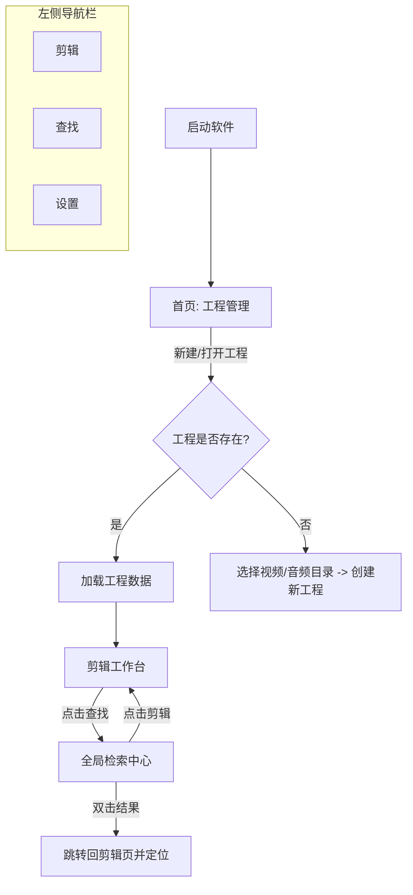
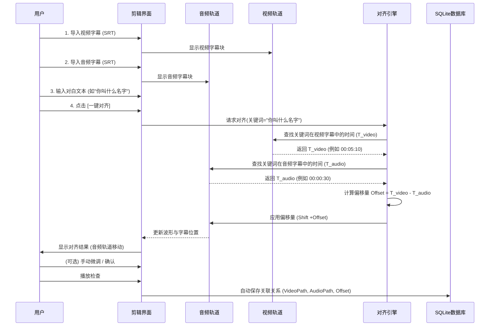
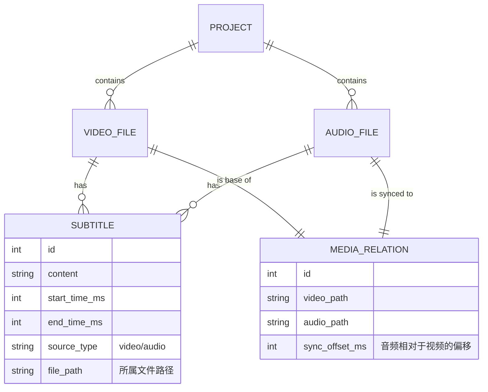

# 采访视频数据管理与检索系统 - 业务流程设计图

本文档包含系统核心业务的流程图设计，请您查阅确认。

## 1. 整体架构与导航逻辑



## 2. 剪辑与自动对齐流程 (核心业务)

此流程展示了如何通过字幕内容自动将无时码器的音频与视频对齐。



## 3. 全局检索与结果交互流程

```mermaid
graph TD
    UserInput[用户输入关键词: "你好"] --> SearchEngine[搜索引擎]
    SearchEngine -->|扫描| DBFiles[\data\metadata\*.db\]
    
    DBFiles -->|SQL查询| QueryResult[匹配的字幕记录]
    
    QueryResult -->|聚合| ResultList[搜索结果列表]
    
    subgraph 结果展示卡片
        Row1[第一行: 视频信息]
        Row1Content[视频文件名 | 时间码 | 路径]
        Row1Btns[按钮: 复制路径 | 打开文件夹]
        
        Row2[第二行: 音频信息]
        Row2Content[音频文件名 | 原始/对齐时间码 | 路径]
        Row2Btns[按钮: 复制路径 | 打开文件夹]
    end
    
    ResultList --> Display[渲染UI界面]
    
    Display -->|点击复制| Clipboard[系统剪贴板]
    Display -->|点击打开文件夹| FileExplorer[资源管理器]
    
    Display -->|双击条目| LinkAction[联动跳转]
    LinkAction -->|1. 切换页面| ClipPage[剪辑页面]
    LinkAction -->|2. 加载工程| LoadProj[加载对应工程]
    LinkAction -->|3. 定位时间| Seek[视频/音频跳转至 StartTime]
    LinkAction -->|4. 自动播放| AutoPlay[播放3秒预览]
```

## 4. 数据库存储模型 (ER图)


